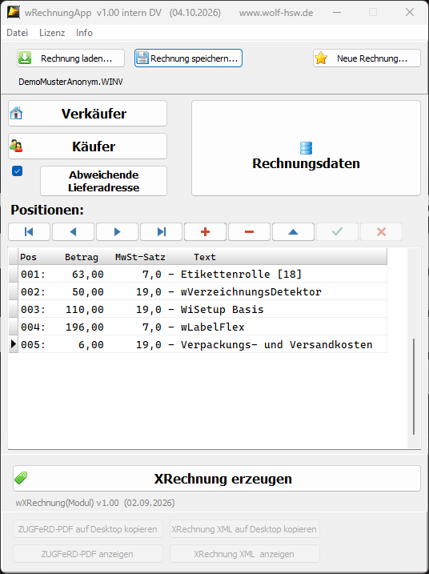
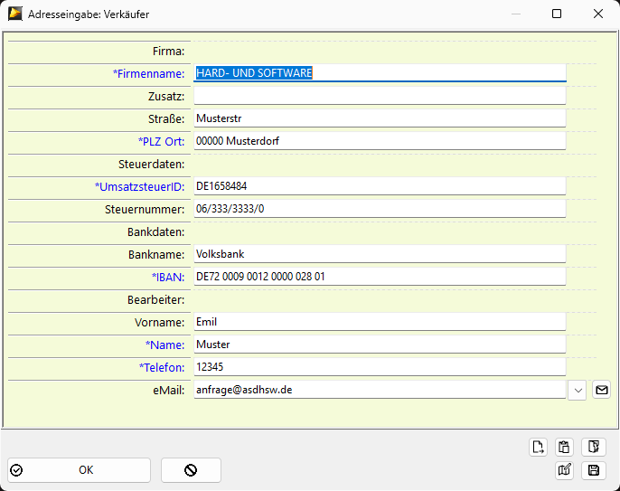
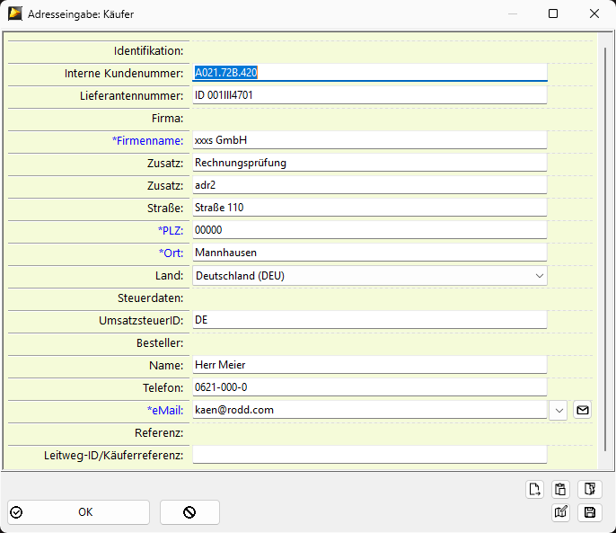
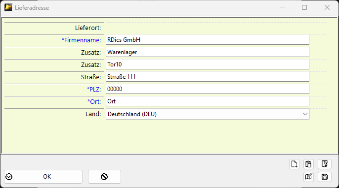
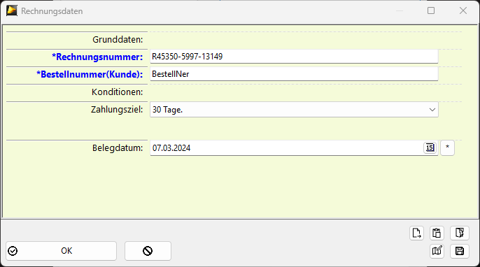
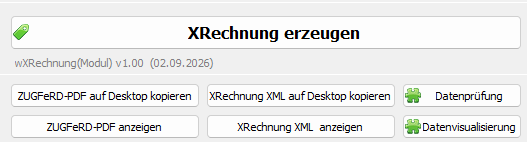
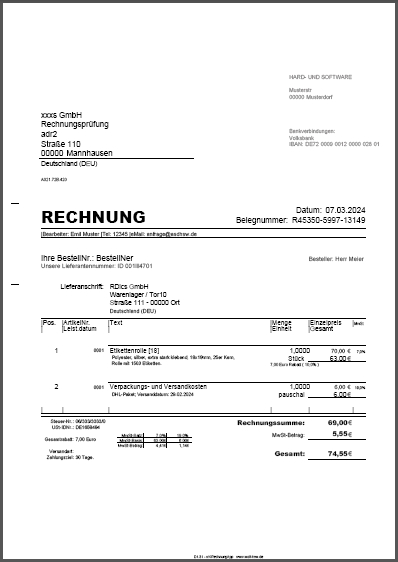
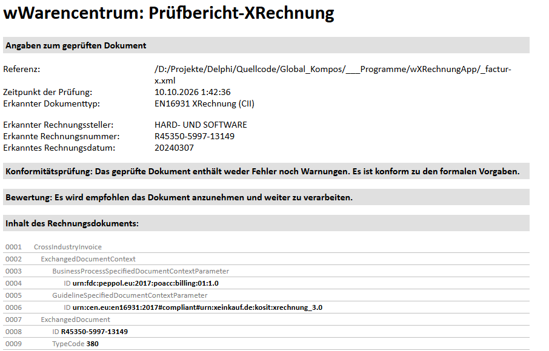
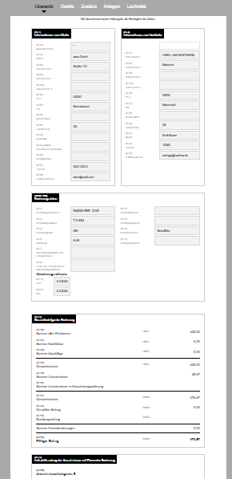

# wXRechnung

## wXRechnung – Einfach Rechnungen erstellen und lesen

**wXRechnung ist ein einfach zu bedienendes, benutzerfreundliches Programm zur Erstellung und Verarbeitung elektronischer Rechnungen.**

Ursprünglich wurde wXRechnung als Entwicklungsträger für unser Warenwirtschaftsprogramm "wWarencentrum" konzipiert, insbesondere zur Implementierung der XRechnung- und E-Rechnungs-Funktionalitäten. Inzwischen steht das Programm auch als eigenständige Lösung zur Verfügung.

### Die wichtigsten Funktionen

Mit wXRechnung können Sie elektronische Rechnungen im Format **XRechnung 3.x** erstellen. Dabei unterstützt das Programm sowohl XML-Dateien als auch die Darstellung von Rechnungen als PDF mit eingebetteter XML.

Die übersichtliche Bedienung macht wXRechnung zu einer praktischen Lösung für kleine Unternehmen, Handwerksbetriebe und Dienstleister, die elektronische Rechnungen unkompliziert erstellen und verarbeiten möchten.

### Kostenlos testen

Sie können wXRechnung kostenlos herunterladen und **14 Tage lang in vollem Umfang und ohne Funktionseinschränkungen testen**.

Nach Ablauf des Testzeitraums beträgt der Preis lediglich **42 € pro Jahr (inklusive Mehrwertsteuer)**.

### Erweiterte Version für professionelle Anwender

Auf Anfrage ist eine erweiterte Version von wXRechnung erhältlich, die speziell auf die Anforderungen professioneller Anwender und Entwickler zugeschnitten ist.

Diese Version lässt sich über eine **ActiveX-Schnittstelle (DCOM)** fernsteuern. Dadurch können externe Programme, individuelle Kundenlösungen oder beispielsweise Microsoft Excel mit den Funktionen zur Verarbeitung von XRechnungen ausgestattet werden.

So lassen sich elektronische Rechnungsfunktionen mit überschaubarem Integrationsaufwand in bestehende Anwendungen und Arbeitsabläufe einbinden.

## Bildschirmbilder der Grundversion

Zentrales Bedienfenster

Verkäufer

Käufer

Abweichende Lieferadresse

Grunddaten der Rechnung

Rechnungserzeugung

Neutrale PDF mit eingebetteter XML

Ausschnitt: Prüfung einer XML-Rechnung

Ausschnitt: Anzeige ein XML-Rechnung

## Systemvoraussetzungen
- Windows 10 / 11
- Festplattenspeicher 600MB (300MB ohne XML-Prüffunktion)
- Internetzugang zur Lizenzprüfung
- Programmsprache: Deutsch

## Installation
- Setup herunterladen.
- Setup ausführen.
- Programm starten.

## Hinweis
Einschränkung, wenn kein Lizenzschlüssel eingetragen wurde:  
Es sind alle Funktionen verfügbar, aber **Achtung**:
Die Rechnungen enthalten beabsichtigte Rechenfehler (PDF und XML)!

## Lizenz
Mit der Lizenz 00000000-1001-0001-0000-000000000000 können Sie das Programm 14 Tage lang im vollen Umfang testen! Es ist keine Registrierung nötig. Einfach Testlizenz im Menü eintragen!

Vollversion: Nach Bestellung und Geldeingang erhalten Sie innerhalb 48h eine Programmlizenz per E-Mail.

Für die volle Funktionsfähigkeit der Software unter allen denkbaren Betriebszuständen eines Rechnersystems kann verständlicherweise keine Garantie übernommen werden. Eine Haftung für die Eignung dieses Programms für einen bestimmten Verwendungszweck, für das fehlerfreie Funktionieren und für Mangelfolgeschäden kann daher nicht übernommen werden. Im übrigen gelten die allgemeinen Vertragsbedingungen für Softwareprogramme.

**Informationen zu Schnittstellen, technischen Möglichkeiten und Preisen der erweiterten Version erhalten Sie auf Anfrage.**

### Details: Erweiterte Version für professionelle Anwender
Hier ein symbolischen Beispiel einer Steuerung mit der erweiterten Programmversion:
 
 //Verkäufer angeben
 fwXR_CMD.SetSeller('Musterfirma', 'Hans Muster', 'Straße 2', '00000 Dorf', 'sBank', 'DE72 009 0000 0000 0270 01', 'Hans', 'Muster', '0000-000', 'anfrage@Mail.ax', '01/ad/sss/s', DE000250874');
 
 //Käufer angeben
 fwXR_CMD.SetBuyer('12345', 'LI789456', 'Muster GmbH', 'Rechnungsstelle', 'ABT:A', 'Straße 1', '00000', 'Musterort', '', 'DE', 'Otto Schmitt', '555-987', 'a@b.ce','123456Ref');
 
 // optional: abweichende Lieferadresse
 fwXR_CMD.SetShipTo('Lager GmbH', 'Tor1', 'Am Wasser 5', 'Lagerstraße', '12345', 'Bestimmungsort', '');
 
 // Rechnungsdaten
   fwXR_CMD.SetInvoiceData('RE11155533', 'Best_89456', '30 Tage', '27.03.2026', 1);
 
// Einzelne Positionen übergeben    
fwXR_CMD.AddPosition('P1', 'Batterie', 'Neuwertiges Ding...', 5, 5, 'Stück', 19, 0,'');
fwXR_CMD.AddPosition('P2', 'Papier', 'Schweres Zeug...', 50, 11.111, 'kg', 7, 5,'01.12.2026');

// XRechnung XML und PDF erzeugen
fwXR_CMD.CreateXRechnung;

Dies ist nur ein Auszug der Steuerungsmöglichkeiten.

Open-Source-Komponenten:
- KoSIT Validator, xrechnung-visualization,validator-configuration-xrechnung, MustangProjekt

Copyright © 10/2026 U.Wolf WOLF Hard- und Software. Alle Rechte vorbehalten.
